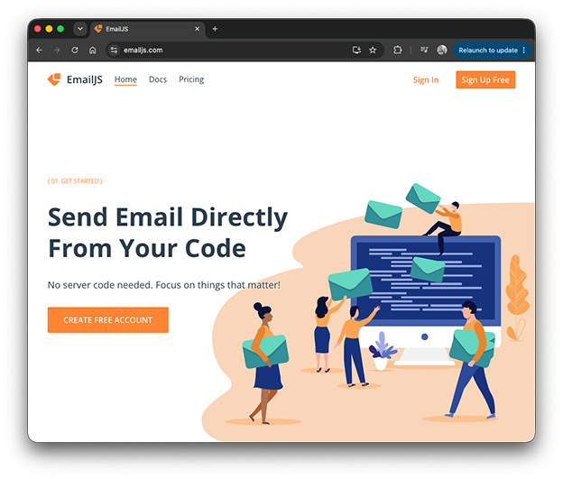

# JavaScript and EmailJS

A basic example of sending an email using JavaScrip and [EmailJS](https://emailjs.com).

Check out the [Send Email Using EmailJS](https://www.youtube.com/watch?v=lRFh7Ep35lc) from [CodeEasy](https://www.youtube.com/@codeeasy3667). 

***

## Repo Resources

* [Visual Studio Code](https://code.visualstudio.com/) or [Brackets](http://brackets.io/) (or any code editor)
* [EmailJS](https://emailjs.com)

 

